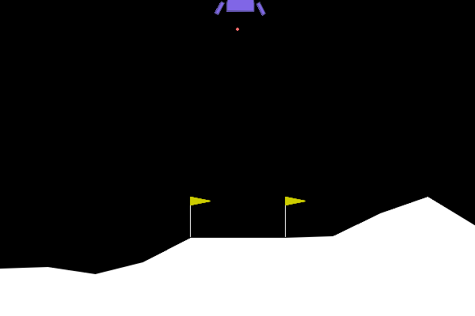
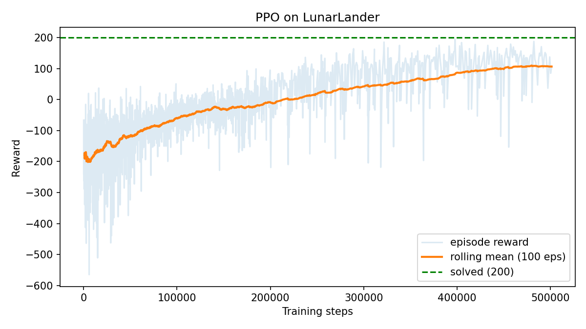

# Rocket RL Lander

[](https://colab.research.google.com/github/eigen/rocket-rl-lander/blob/main/rocket_lander_colab.ipynb)

Reinforcement learning agent that learns to land the Gymnasium **LunarLander** spacecraft using
**PPO** (Stable-Baselines3). Trains on CPU in Google Colab; no GPU needed.




## Results

Evaluated on the standard (unshaped) environment with a deterministic policy: 100 episodes, seed 0.

| Timesteps | Custom shaping | Mean reward | Success rate (reward ≥ 200) |
|-----------|----------------|-------------|-----------------------------|
| 500,000   | none           | 223.4       | 89%                         |

Raw numbers are in `results/metrics.json`.

## How it works

- **Environment:** `LunarLander-v3`. The agent sees 8 values (position, velocity, angle, angular
  velocity, two leg contacts) and picks one of 4 actions (nothing, left, main, right engine).
- **Reward:** the environment already provides a shaped reward (closer to pad, slower, more upright,
  leg contact, +100 landing, -100 crash, small penalties for firing engines).
- **Optional extra shaping:** `--shaping-bonus 0.05` adds a small per-step bonus for staying upright.
  Large bonuses cause hovering instead of landing, so compare against the baseline.
- **Algorithm:** PPO with an MLP policy (64, 64) and 16 parallel environments.

## Run

```bash
git clone https://github.com/eigen/rocket-rl-lander.git
cd rocket-rl-lander
pip install -r requirements.txt   # may need: pip install swig
python train.py --timesteps 500000
python demo.py
```

Or open the notebook in Colab: `rocket_lander_colab.ipynb`.

## Layout

```
train.py   training, evaluation, reward plot
demo.py    record landings to GIF/MP4
model/     trained policy (rocket_lander_ppo.zip)
results/   metrics.json, reward_curve.png
videos/    landing.gif, landing.mp4
```

## Ideas to extend

Compare shaping vs. no shaping across several seeds, try SAC on `continuous=True`, or train with
curriculum (e.g. increasing wind).
